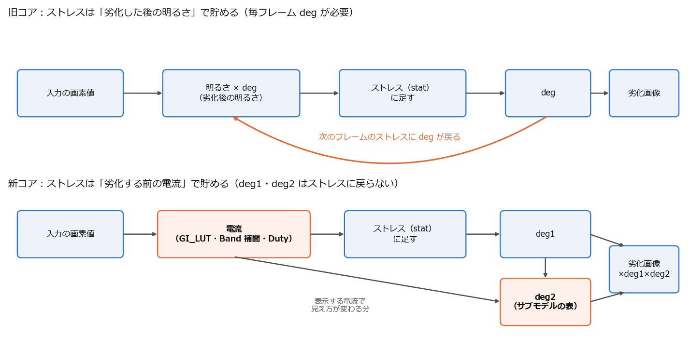
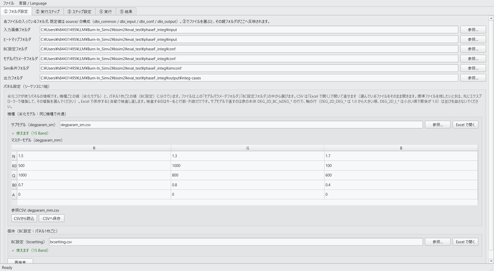
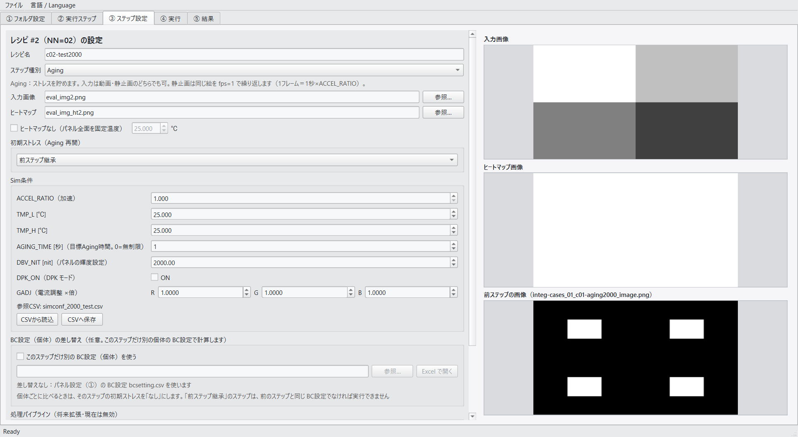
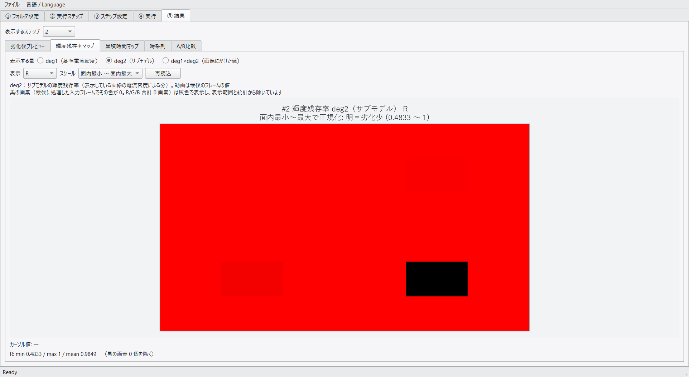
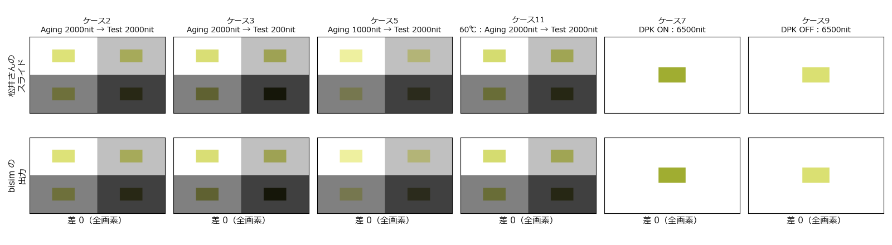
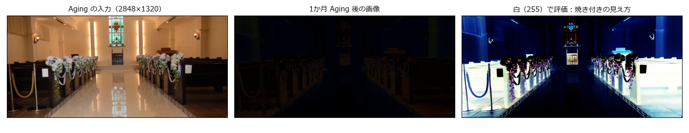
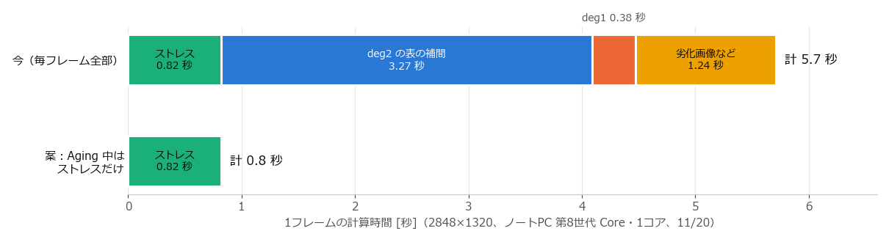

<!-- _class: lead -->
<!-- _paginate: false -->
<!-- _header: '' -->

# 劣化シミュレータ GUI開発
## 進捗報告 07：新コアの組み込み（フェーズF）

**報告日** 2026/11/24　**報告者** 堀部
**対象期間** 2026/11/12 〜 11/24

---

## 0. 進捗状況サマリ

**(1) 松井さんの新コア（Burn_in_sim_core_01、11/10 release）を BI-Sim に組み込んだ**
- 新しい入力（BC設定・サブモデル・表示条件）を GUI から設定できるようにした
- サブモデルの劣化（deg2）を ⑤結果で表示・CSV で出力できるようにした

**(2) 評価：すべて OK**
- 松井さんの動作確認 11 ケースを BI-Sim で再現 → **出力画像・stat・deg とも差 0**
- 理論確認テスト（3色円）を新コアの式で作り直し → **理論値と一致**
- 別PC（EXE）でも開発PCと**バイト単位で同じ結果**

**(3) 処理負荷の重いデータ（実機サイズ 2848×1320）で計算時間を確認** → 高速化の案を整理（実装は保留）

---

<!-- _class: tight -->

## 1. 新コアで変わったこと（コア側の要点）

- **ストレスの元が「劣化後の明るさ」→「劣化前の電流」に**（GI_LUT・Band 補間・Duty から求める）
- **サブモデル（deg2）を追加**：同じ劣化でも、表示する電流（階調・輝度設定）で見え方が変わる分
- 劣化画像 ＝ 入力 × deg1（基準電流密度の残存率）× deg2
- マスターモデル（N・K0・Q・B0・A）と deg1 の式は従来どおり

---

<!-- _class: tight -->

## 1. 新コアで変わったこと：入力・出力

| 区分 | 追加・変更 | 内容 |
|---|---|---|
| 入力 | `bcsetting.csv`（新形式） | Band ごとのピーク輝度・Duty・電流、GI_LUT（階調→電流の表）。**個体ごと** |
| 入力 | `degparam_sm.csv`（新規） | サブモデルの表（電流 × 劣化度 → deg2）。Band × RGB。**機種ごと** |
| 入力 | `degparam_mm.csv` | 従来どおり。**機種ごと** |
| 入力 | Sim 条件に3項目 | `DBV_NIT`（輝度設定）・`DPK_ON`（DPK モード）・`GADJ`（電流調整 R/G/B） |
| 出力 | `deg2_{r,g,b}.csv`（新規） | サブモデルの残存率（動画は最後のフレームの値） |

- 「機種ごと／個体ごと」の区別は松井さんの回答（11/17）による

---

<!-- _class: tight -->

## 2. UI の変更：① フォルダ設定に「パネル設定」欄

- パネル設定（BC設定・サブモデル・マスターモデル）を**シーケンスに1組**持つ
- 「機種（劣化モデル）」と「個体（BC設定）」に分けて表示
- ファイルごとに**検査結果（✓／✗）**、「**Excel で開く**」。Excel で保存すると**自動で検査し直す**
- マスターモデルの表は ③ から ① へ移動（ステップごとではなくパネルの特性のため）

---

<!-- _class: tight -->

## 2. UI の変更：③ ステップ設定に表示条件・BC設定（個体）の差し替え

- Sim 条件に **DBV_NIT・DPK_ON・GADJ** を追加（**PQ評価のステップでも設定できる**）
- **BC設定（個体）の差し替え**（任意）：このステップだけ別の個体の BC設定で計算できる（個体ごとに Aging を比べる用途）
  - 「前ステップ継承」のステップは、前のステップと同じ BC設定でなければ実行できない（個体Aで劣化させたパネルを個体Bとして続けないため）
  - 「機種ごと」のサブモデル・マスターモデルは ① で1つ（松井さんの「機種ごと／個体ごと」に合わせた）
- 旧形式のシーケンスは、開いたときに標準のパネル設定を自動で割り当てる

---

<!-- _class: tight -->

## 2. UI の変更：⑤ 結果で deg1／deg2／deg1×deg2 を切り替え

- 「表示する量」を **deg1（基準電流密度）／deg2（サブモデル）／deg1×deg2（画像にかけた値）** から選ぶ
- スケールは「0〜1」「面内最小〜最大」。黒の画素（電流 0）は deg2 では灰色にして統計から除く
- 例（上図）：4つの白い四角で Aging → 4階調のパターンで表示。**低い階調（右下 W64）ほど deg2 が下がる**

---

<!-- _class: tight -->

## 2. UI の変更：その他

- **出力**：`…_deg2_{r,g,b}.csv` を追加（停止したときの途中結果にも保存）
- **シーケンスのフォルダの保存方法**（追加の改善）
  - シーケンスファイルの下のフォルダは**相対パス**で保存
  - シーケンスとデータを1つのフォルダにまとめれば、**フォルダごと別PCへコピーして開くだけで動く**
- **累積 Aging 時間の表示**（不具合修正）：初期ストレス「なし」のステップでは 0 から数え直す
- 自動テスト（selftest）：93 本 → **123 本**、すべて合格

---

<!-- _class: tight -->

## 3. コアに手を入れた理由（BI-Sim 側の追加）

| 追加・修正したもの | 理由 |
|---|---|
| `burn_in_band_extract`（Band 選択の関数） | **GUI の機能とインターフェースの仕様に合わせるため**。GUI は1フレームずつ `burn_in_core` を呼ぶので、その前準備（Band 選択）を単独で呼べるように、`burn_in` の中の処理を関数として切り出した |
| `burn_in_core` に省略可能な引数 `deg2_r/g/b` | deg2 はコアの中だけで使われ、外に出ていなかった。⑤の表示と CSV 出力のため |
| エラー検出の修正 | 設定ファイルの誤りに気づかずに計算が進まないようにするため（次のページ） |

- いずれも**式は一切変えていない**
- 松井さんの単独実行（`burn_in`）の使い方と結果（stat・deg・画像）は従来どおり。違いは、deg2 の CSV が増えることと、設定ファイルの誤りで止まるようになったことだけ
- 追加の前後で、松井さんの 11 ケースの結果が変わらないことを確認（差 0）

---

<!-- _class: tight -->

## 3. コアに手を入れた理由（詳細）

**`burn_in_band_extract`（Band 選択の関数化）**
- 受け取ったコアには、全フレームを中で回す `burn_in`（コマンドライン用）と、1フレーム分の `burn_in_core` があった
- GUI は、中断・停止・再開、AGING_TIME での周回・打ち切り、進捗とプレビューの表示のため、フレームのループを自分で回し、1フレームごとに `burn_in_core` を呼ぶ → 最初から最後までを1回で行う `burn_in` は使えない
- `burn_in_core` には Band の準備データ（GI_LUT・ピーク電流・Duty・サブモデルの表など約 10 種類）を渡す必要があるが、その準備は `burn_in` の中に直接書かれていて（約 160 行）、外から呼べなかった
- BI-Sim 側に書き写すと、コアが直されたときに古いまま残るため、**同じコードをコアの中で関数として取り出した**（`burn_in` 自体は変えていない）
- 準備データは設定だけで決まり、画像にはよらないので、ステップの最初に1回だけ呼ぶ

**エラー検出の修正**
- サブモデル（`degparam_sm.csv`）の読み込みに失敗しても、気づかずに計算が進むことがあった → 失敗をログに書いて止める（キー行の欠落・表が空も失敗とする）
- サブモデルと BC設定の Band 数が違っていたら、ログに書いて止める
- GUI では、① パネル設定欄のファイル検査（✓／✗）とエラー表示に使っている

---

<!-- _class: tight -->

## 4. 評価①：松井さんの動作確認 11 ケースを BI-Sim で再現

- 松井さんの資料（Core Part in simulator_brief confirmation result）と**同じ入力・条件**を、BI-Sim のシーケンスで実行
- 11 ケースすべてで **stat・deg・出力画像が差 0**。スライドの画像（上段）とも**全画素で差 0**
- 動画（480×270・405 フレーム）も、コマンドライン実行の結果と stat・deg・deg2 が差 0

---

<!-- _class: tight -->

## 4. 評価②：理論確認テスト・別PC

- **理論確認テスト（3色円）を新コアの式で作り直した**
  - 式とパネル設定ファイルの読み込みを、コアとは**別に独立して実装**（Python）
  - Excel の数式による検算ブックも作り直し（サブモデルの表の補間も数式で計算）
  - 結果：**全14ステップが理論値と一致**（差 10⁻¹³ 以下、評価画像は差 0）、Excel 検算 **21 項目 OK**
- **別PC（EXE）での確認**
  - 11 ケース・理論確認テストとも OK
  - 出力の CSV は開発PCの結果と**バイト単位で同じ**（11 ケース 108 ファイル、3色円 126 ファイル）

---

<!-- _class: tight -->

## 4. 評価③：処理負荷の重いデータで実行

**実機サイズ（2848×1320）の静止画で1か月の Aging**（ACCEL_RATIO 3000 → 864 フレーム）

| PC | 1か月（864 フレーム） | 1フレームあたり |
|---|---|---|
| デスクトップ（第13世代 Core・28コア） | **約 60 分** | 約 4.2 秒 |
| ノート（第8世代 Core・4コア） | 約 85 分〜5 時間（PC の状態で変わる） | 約 6〜20 秒 |

- 今の BI-Sim は **1コアしか使わない**ので、28コアのデスクトップでもノートの約 1.4 倍の速さ
- **動画（30fps）は同じ1か月で 30 倍のフレーム数**（25,920 フレーム）→ ノートで約 42 時間の見込み

---

<!-- _class: tight -->

## 5. 計算時間の内訳と高速化の案（実装は保留）

- 時間のほとんどは**劣化画像を作る計算**（deg2 の表の補間・deg1・画像）。ストレスの計算は軽い
- 新コアは deg1・deg2 がストレスに戻らないので、**Aging 中は毎フレームストレスだけ計算し、deg1・deg2・画像は最後に1回**でも、結果は同じ（小さい例で確認済み）
- 案：① deg1・deg2 を最後に計算　② 毎フレームの劣化画像作りをやめる　③ 並列化（4コアで約 1.8 倍）
- 見込み（動画 1か月・実機サイズ）：**約 42 時間 → ①② で約 6 時間 → ③ も入れて約 4 時間**

---

<!-- _class: tight -->

## 6. 今後・松井さんへの確認事項

**松井さんに確認したいこと**
- ストレスの元を「劣化後の明るさ」から「劣化前の電流」に変えたのは意図どおりか。**今後もストレスに deg を戻さない前提でよいか**（高速化の案の前提）
- DBI 補正を入れると、劣化に応じて電流が変わる → そのときの扱い（補正の更新の間隔など）
- `GADJ` の意味、機種ごとのサブモデルと個体ごとの BC設定の関係、低電流で deg2 が大きく下がる表の形は意図どおりか

**今後**
- 高速化（上記 ①〜③）は、松井さんの確認の後に進め方を決める
- 当面の工夫：**整数周になるよう ACCEL_RATIO を大きくする**と、新コアでは結果を変えずにフレーム数を減らせる（例：60 秒の動画で1か月 → ACCEL_RATIO 43,200 で1周）
