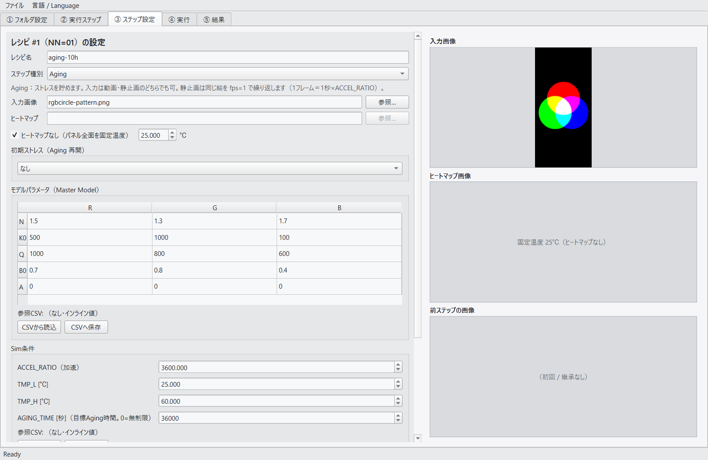
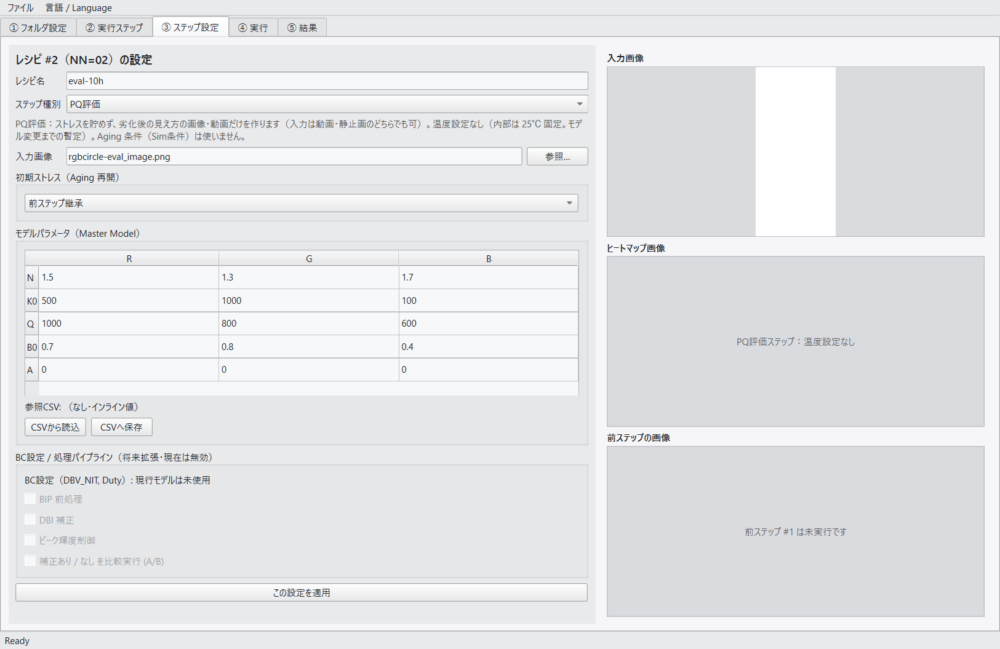
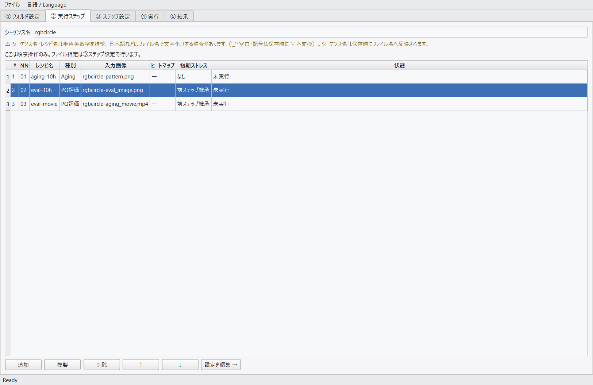
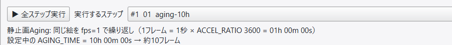
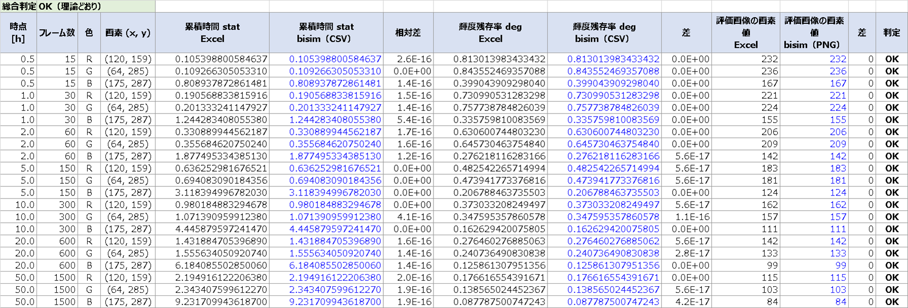
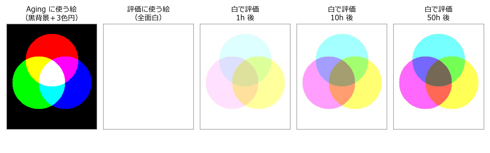
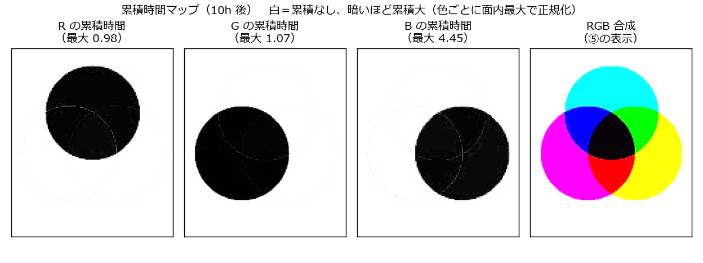
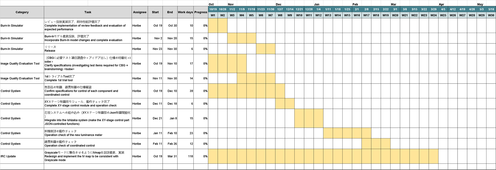

<style>
section {
  font-family: "Meiryo", "Yu Gothic", "Hiragino Kaku Gothic ProN", "Noto Sans CJK JP", sans-serif;
  font-size: 24px;
}
h1 { font-size: 36px; }
h2 { font-size: 30px; }
h3 { font-size: 22px; color: #555; }
ul { line-height: 1.5; }
section.tight { font-size: 19px; }
section.tight h2 { font-size: 26px; }
section.xtight { font-size: 16px; }
section.xtight h2 { font-size: 24px; }
section header { font-size: 13px; color: #999; }
section.lead { text-align: center; }
table { font-size: 0.9em; }
img { background: white; }
</style>

<!-- _class: lead -->
<!-- _paginate: false -->
<!-- _header: '' -->

# 劣化シミュレータ GUI開発
## 進捗報告 05

**報告日** 2026/10/22　**報告者** 堀部
**対象期間** 2026/10/15 〜 10/22

---

## 0. 進捗状況サマリ

**(1) 前回指摘（10/15 進捗MTG）への対応と評価**
- **機能修正**：Type の自動判定をやめ、**Aging／PQ評価を手動で選ぶ**方式に変更。
  静止画でも Aging、動画でも評価できるようにした（指摘2・3 も対応）
- **性能評価①**：R/G/B の円のパターンで、**理論値（計算）と BI-Sim の結果が完全に一致**することを確認
  （Python と Excel の2通りで計算。別PCでビルドした EXE で確認）
- **性能評価②**：劣化画像の見え方（色づき方）と累積時間マップを確認
- 未実施：ヒストグラム表示（No.8）、累積時間マップの表示変更（No.9）

**(2) 堀部担当業務のスケジュール化**（4テーマ並行・2027年3月まで）

---

<!-- _class: tight -->

## 1-1. 機能修正：ステップ種別（Aging／PQ評価）を手動で選ぶ

**経緯**：指摘「Type の表記が動画／画像選択と整合しない」→ 議事録では「削除の方向」
→ 検討の結果、**拡張子で自動判定する仕様そのものがおかしい**と判断
（動画は必ず Aging、静止画は必ず評価、になってしまい、評価のときも Aging 条件が設定できていた）

| 組み合わせ | 動作 |
|---|---|
| Aging × 動画 | 従来どおり（1フレーム ＝ 1/fps 秒 × ACCEL_RATIO） |
| **Aging × 静止画**（新規） | 同じ絵を **fps=1** で繰り返す（1フレーム ＝ 1秒 × ACCEL_RATIO）。回数は AGING_TIME で決まる |
| PQ評価 × 静止画 | 劣化した状態に表示したときの見え方の画像を作る（ストレスは貯めない） |
| **PQ評価 × 動画**（新規） | 劣化した状態での見え方の動画を作る（ストレスは貯めない） |

- **PQ評価は劣化状態の色づきを見るためだけ**のステップ → **Sim条件（Aging条件）と温度の設定をなくした**
  （温度は内部 25℃固定。モデル変更までの暫定）
- ③ステップ設定で Aging／PQ評価 を選ぶと、**表示される設定項目が切り替わる**
- 以前のシーケンスファイルは従来どおり拡張子から種別を決めるので、そのまま使える

---

<!-- _class: tight -->

## 1-1. 画面：Aging と PQ評価で表示項目が変わる

<div style="display:flex; gap:16px; align-items:flex-start;">
<div style="flex:1;">

**Aging**（ヒートマップ・Sim条件あり）


</div>
<div style="flex:1;">

**PQ評価**（ヒートマップ・Sim条件なし）


</div>
</div>

②実行ステップの「種別」列と、④実行タブの見積り表示（静止画 Aging の例）

 

---

<!-- _class: tight -->

## 1-1. その他の指摘への対応

| 指摘（Excel No.） | 対応 |
|---|---|
| 動画と静止画で画像サイズが違っても選べてしまう（No.3） | ③でファイルを選んだ時点で、**シーケンスで最初に選んだ画像のサイズ**と比べ、違えば注意メッセージを出して**選択できない**ようにした（動画・静止画は問わない。ヒートマップも対象） |
| 「Previous Aging Result」の文言がおかしい（No.4） | 「**前ステップの画像** / Previous step image」に変更 |

- 回答は `劣化Sim_ツール評価結果_261019.xlsx` の No.2〜4 に追記
- 別PCで再ビルドした EXE で動作確認（`261021B_動作確認チェックリスト.md`）：
  種別の切替・PQ評価×動画・サイズ検査・文言など **主要項目は OK**

---

<!-- _class: tight -->

## 1-2. 性能評価①：理論値との比較 — テストの考え方

**目的**：BI-Sim が劣化モデルの式どおりに計算しているかを、**数値で確かめる**

- **Aging の絵**：黒背景に R・G・B の円を重ねた静止画（横240×縦512）を動画にしたもの
- **評価の絵**：全面白
- **条件**：ACCEL_RATIO=3600（1フレーム＝120秒、動画1周回＝1時間）、固定温度 25℃、モデルパラメータは既定値
- **手順**：Aging → 白で評価 を 7回つなげ、累積 0.5h／1h／2h／5h／10h／20h／50h で結果を出す（14ステップ）

**劣化モデルの式**（1フレームずつ順に計算する）

```
deg(k)  = exp( −stat(k−1)^β )                      … フレーム開始時の輝度残存率
lum(k)  = (画素値/255)^2.2 × deg(k)                 … 劣化した後の輝度
stat(k) = stat(k−1) + Δt × ACCEL_RATIO × lum(k)^N ÷ ( K0 × exp(Q ÷ T) )   … 累積時間
評価画像の画素値 = INT( 255 × deg^(1/2.2) )
```

**ポイント**：劣化した後の輝度でストレスを貯めるので、劣化が進むほど貯まり方が遅くなる
→ 「時間×一定量」の掛け算では出せず、**1フレームずつ積み上げて計算**する必要がある

---

<!-- _class: tight -->

## 1-2. 性能評価①：結果 — 理論値と完全に一致

理論値を **BI-Sim とは別に2通り**で計算し、別PCでビルドした EXE の出力と比べた

| 計算方法 | 比べたもの | 結果 |
|---|---|---|
| Python（`tools/rgbcircle_theory.py`） | 全画素・全14ステップの累積時間・輝度残存率・評価画像 | **差 0（完全一致）** |
| **Excel の数式**（`理論値_Excel検算.xlsx`） | R/G/B の円の画素 × 7時点（21項目） | **15桁一致**（差は最大 5×10⁻¹⁶＝計算機の最後の1桁） |

**数値例**（R の円、1時間後）

| | 累積時間 stat | 輝度残存率 deg | 評価画像の画素値 |
|---|---|---|---|
| 理論値（Excel） | 0.190568833815916 | 0.730990531283298 | 221 |
| BI-Sim（別PC EXE） | 0.190568833815916 | 0.730990531283298 | 221 |

→ **BI-Sim は劣化モデルの式どおりに計算している**ことを確認。
コアモデルを差し替えた後も、同じテストでそのまま確認できる

---

<!-- _class: xtight -->

## 1-2. Excel による検算（比較シート）



- 「計算」シートは1行1フレーム（0〜1500フレーム＝50時間）。各列の Excel の数式も文字で表示している
- パラメータを書き換えると全体が再計算される（モデル変更後の検算にも使える）

---

<!-- _class: tight -->

## 1-3. 性能評価②：劣化画像の見え方（色づき方）



- 白で評価すると、**Aging で光らせた場所に焼き付きが「補色」で見える**
- 時間が経つほど色づきが濃くなる（1h → 10h → 50h）
- 背景（Aging 中は黒＝光っていない）は劣化せず、白のまま

---

<!-- _class: tight -->

## 1-3. 色づき方の対応（10h 後・実測値）

| Aging 中に光っていた色 | 劣化した色 | 白で評価したときの色 | 画素値 (R, G, B) |
|---|---|---|---|
| 赤の円だけ | R | **水色**（G・B が残る） | (164, 255, 255) |
| 緑の円だけ | G | **ピンク**（R・B が残る） | (255, 158, 255) |
| 青の円だけ | B | **黄色**（R・G が残る） | (255, 255, 113) |
| 赤＋緑（黄色の所） | R と G | **青**（B だけ残る） | (163, 158, 255) |
| 赤＋青（マゼンタの所） | R と B | **緑**（G だけ残る） | (164, 255, 112) |
| 緑＋青（シアンの所） | G と B | **赤**（R だけ残る） | (255, 158, 112) |
| 中央（白） | R・G・B 全部 | 黄みがかった灰色（B が一番劣化） | (164, 158, 113) |
| 背景（黒） | なし | 白のまま | (255, 255, 255) |

- **劣化した色が抜けて、残りの色が強調される**。評価画像に赤・緑・青が見えるのは「2色が重なっていた所」
- B が一番速く劣化する（K0 が小さく、β が小さいため）→ 白だった中央は黄みがかる

---

<!-- _class: tight -->

## 1-3. 階調の対応表：R/G/B がそれぞれ劣化したときの値

その色が 255 で光っていた画素の、白で評価したときの値（理論値。BI-Sim と一致）

| 累積 Aging 時間 | 0.5h | 1h | 2h | 5h | 10h | 20h | 50h |
|---|---|---|---|---|---|---|---|
| **R** 輝度残存率 | 0.813 | 0.731 | 0.631 | 0.483 | 0.373 | 0.276 | 0.177 |
| **R** 評価画像の画素値 | 232 | 221 | 206 | 183 | 162 | 142 | 115 |
| **G** 輝度残存率 | 0.844 | 0.758 | 0.646 | 0.474 | 0.348 | 0.241 | 0.139 |
| **G** 評価画像の画素値 | 236 | 224 | 209 | 181 | 157 | 133 | 103 |
| **B** 輝度残存率 | 0.399 | 0.336 | 0.276 | 0.207 | 0.163 | 0.126 | 0.088 |
| **B** 評価画像の画素値 | 167 | 155 | 142 | 124 | 111 | 99 | 84 |

- 画素値 ＝ INT( 255 × 輝度残存率^(1/2.2) )。ガンマのため、輝度が 0.373 に落ちても画素値は 162（約64%）
- 現在のモデルパラメータは暫定で、劣化がかなり速い（1h で R は 73% まで低下）
- 実際の動画（MP4）は非可逆圧縮のため、画素によっては ±2 程度ずれる（前ページの実測値）

---

<!-- _class: tight -->

## 1-3. 累積時間マップの見え方（10h 後）



- 各色の累積時間は、**その色が光っていた円の中だけ**に貯まる（光っていない所は 0 ＝白）
- 値の大きさは色で違う：R 0.98、G 1.07、**B 4.45**（B は貯まりやすい）
- ⑤の表示は色ごとに面内最大で合わせて明暗を反転しているので、RGB 合成は評価画像と同じ
  **補色のパターン**になる（評価画像より色がはっきり出るのは、色ごとに最大値で正規化しているため）

---

<!-- _class: tight -->

## 1-4. 未実施の項目と、評価で見つかった点

**未実施**

| Excel No. | 内容 | 状況 |
|---|---|---|
| No.8 | ブロック分割統計＋ヒストグラム表示 | 仕様確認待ち（出す統計量・出力形式・画面配置） |
| No.9 | 累積時間マップの表示変更（面内最小を 0 にしてスケーリング） | 仕様確認待ち：①対象は累積時間マップだけか ②明暗の向き（今は累積大＝暗） |

**別PC評価で見つかった点（原因判明・修正予定）**
- 「名前を付けて保存」すると元のシーケンスファイルが消える → 元のファイルを残すよう修正
- ③でファイルを選ぶと、未適用の入力（初期ストレス等）が元に戻る → 入力を保持するよう修正
- 停止→再開の完了後、空の停止フォルダが残ることがある（エクスプローラーで開いていたため）
- 静止画 Aging の劣化の値がチェックシートの期待値と合わない → 計算は理論と一致済みのため、条件（温度など）をそろえて再確認中

---

<!-- _class: tight -->

## 1-5. ご相談：計算の刻みで結果が変わる

同じ「10時間の Aging」でも、1フレームあたりの時間（刻み）で結果が変わる

| 刻み（1フレーム） | フレーム数 | R の輝度残存率 | G | B |
|---|---|---|---|---|
| 3600秒（1時間） | 10 | 0.360 | 0.335 | 0.124 |
| 360秒（6分） | 100 | 0.372 | 0.347 | 0.162 |

- 劣化モデルを1フレームずつ足し上げる計算のため、**刻みが粗いと劣化が大きめに出る**（B で約3割の差）
- 500h〜1000h の長時間 Aging では ACCEL_RATIO を大きくしがち → 影響が出やすい
- **ACCEL_RATIO（刻み）の決め方の目安を決めるか、コア側で細かく分けて計算するか**、ご相談したい

---

<!-- _class: xtight -->

## 2. 堀部担当業務のスケジュール（4テーマ並行）



- 時期は終了の目安（上旬＝10日、中旬＝20日、下旬＝月末）。各テーマの最初の項目は 10/19 開始
- 原本：`schedule/261019_horibe_schedule_EN.xlsx`（日本語版 `261019_horibe_schedule.xlsx`）

---

<!-- _class: tight -->

## 2. スケジュールの要点

| テーマ | 主なマイルストン |
|---|---|
| **Burn-In Simulator** | 10月末：レビュー反映・期待性能評価 完了 → 11月中旬：Burn-In モデル変更の反映・評価 → **11月末：リリース** |
| **画質評価Tool** | 11月上旬：仕様の明確化（礒部さん。CBG に必要なテスト項目の調査＋アイデア出し）→ 11月末：1st トライアル Tool |
| **制御システム** | 12月上旬：各部品・連携制御の仕様確認 → 12月中旬：XYステージ制御モジュール → 1月上旬：石坂システムへの組み込み → 2月上旬：新輝度計 → 2月末：連携制御の動作チェック |
| **IRC Update** | 3月末：Grayscale モードに合わせた IVmap の設計変更・実装（V-I でも Gamma 補正のように扱う） |

- Burn-In Simulator は、10月末のマイルストン（レビュー反映・期待性能評価）に対して**予定どおり**
- 11月のモデル変更反映は、松井さんのコアモデルの受領時期に依存

---

## 3. 今後の予定

| 時期 | 内容 |
|---|---|
| 〜10月末 | 別PC評価で見つかった不具合の修正、静止画 Aging の再確認、EXE 再ビルド |
| 〜10月末 | No.8・No.9 の仕様確認 → 対応 |
| 11月 | Burn-In モデル変更（コア差し替え）の反映 → 理論確認テスト（Python・Excel）で確認 |
| 11月末 | BI-Sim リリース |
| 11月 | 画質評価Tool：仕様の明確化 → 1st トライアル |

---

<!-- _class: ref -->

###### 参考：関連ドキュメント

- `docs/review/劣化Sim_ツール評価結果_261019.xlsx` — 前回指摘への回答（No.2〜4 更新、No.9 追加）
- `docs/progress/261021B_動作確認チェックリスト.md` — 別PC（EXE）での動作確認結果
- `eval_test/rgbcircle/` — 理論確認テスト一式（README・理論値・`理論値_Excel検算.xlsx`）
- `eval_test_other-PC/rgbcircle/output/` — 別PCで実行した BI-Sim の出力
- `docs/GUI仕様.md` — ステップ種別・画像サイズ検査の仕様
- `schedule/261019_horibe_schedule_EN.xlsx` — 堀部担当業務のガントチャート
