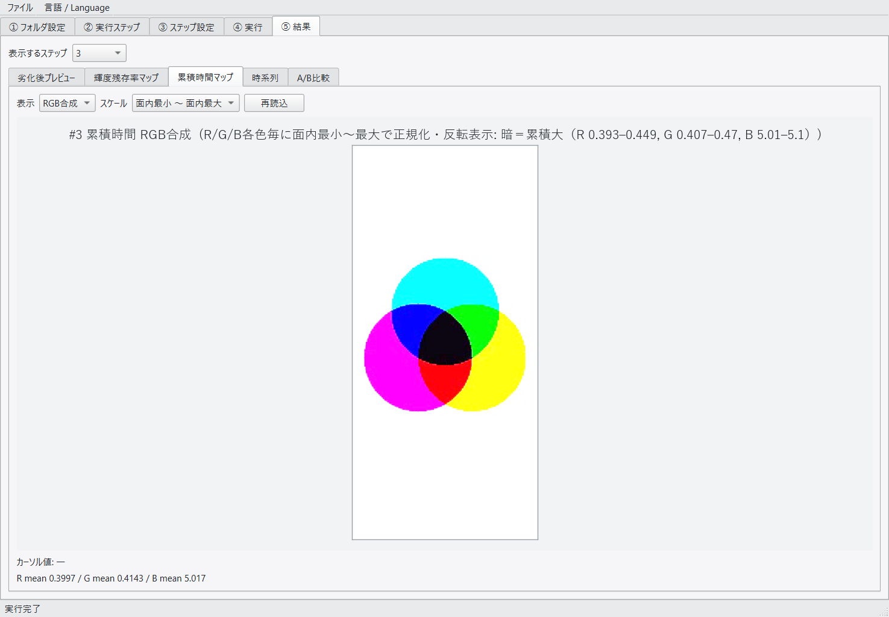
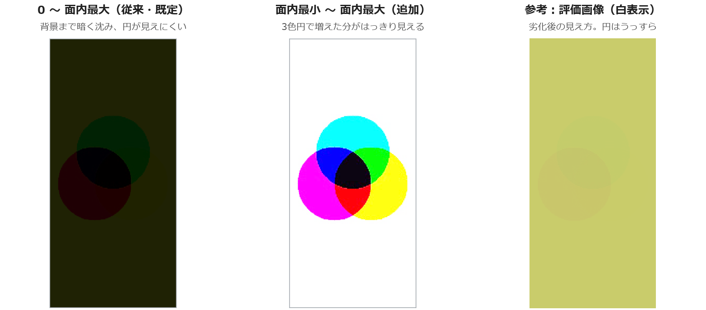
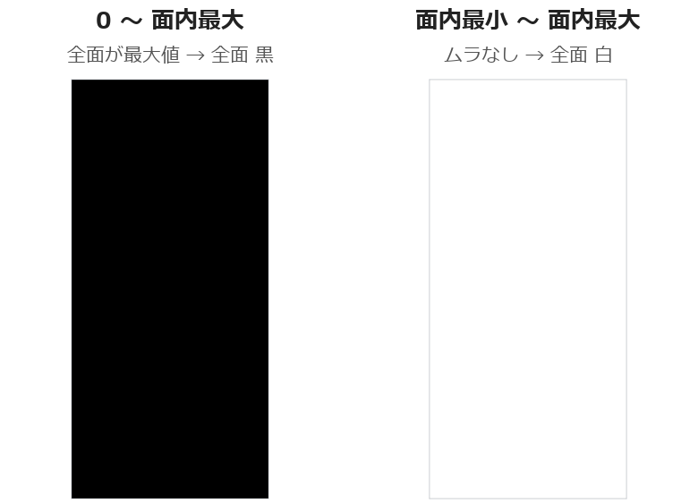

<!-- _class: lead -->
<!-- _paginate: false -->
<!-- _header: '' -->

# 劣化シミュレータ GUI開発
## 進捗報告 06

**報告日** 2026/10/29　**報告者** 堀部
**対象期間** 2026/10/22 〜 10/28

---

## 0. 進捗状況サマリ

**(1) レビュー指摘（Excel No.1〜9）への対応**
- **No.8（ブロック分割統計＋ヒストグラム）以外は、すべて対応済み**
- No.8 は BI-Sim には入れず、**別に作成する画像解析ツールで対応する**方針（仕様の論点は 4. に記載）

**(2) 累積時間マップの表示方式の追加（No.9）**
- 表示のスケールを「**0〜面内最大**」と「**面内最小〜面内最大**」で切り替えられるようにした
- 確認用のデータで、**前のステップで全面に貯まった分に埋もれず、そのステップで増えた分が見える**ことを確認

**(3) 前回の別PC評価で見つかった不具合の修正** → 別PC（EXE）で再確認し、**全項目 OK**（10/28）

---

<!-- _class: tight -->

## 1. レビュー指摘の対応状況（Excel No.1〜9）

| No. | 内容 | 状況 |
|---|---|---|
| 1 | シーケンスの保存・読込の方法 | 回答済み（メニュー「ファイル」から） |
| 2 | Type（種別）の仕様 | 対応済み：**Aging／PQ評価を手動で選ぶ**方式に変更 |
| 3 | 画像サイズが違うファイルを選べてしまう | 対応済み：選んだ時点で検査し、選択させない |
| 4 | 「前ステップの画像」の表示内容 | 回答済み・文言変更。表示が消える不具合も修正 |
| 5 | 輝度残存率マップの名称 | 対応済み |
| 6 | 累積時間マップの明暗反転 | 対応済み（暗＝累積大） |
| 7 | フレームスライダに Aging 時間を併記 | 対応済み |
| **8** | **ブロック分割統計＋ヒストグラム** | **画像解析ツール（別ツール）で対応予定** |
| **9** | **累積時間マップのスケーリング（面内最小を基準に）** | **対応済み（10/23）**：今回の主な報告 |

- 回答・対応内容は `劣化Sim_ツール評価結果_261028.xlsx` のコメント欄に記載
  （今回、コメント欄は過去の経緯を消して**最新の状態だけ**に書き直した）

---

<!-- _class: tight -->

## 2-1. 累積時間マップの表示スケール（No.9）：何を変えたか

**指摘**：初期の状態を 0、面内の最大を 255 としてスケーリングできないか

**困っていたこと**：前のステップから累積時間を引き継ぐと、**全面が底上げ**される。
従来の表示（0 を基準）では、全面が「ほぼ最大」に見えて、**そのステップで増えた分のムラが見えない**

**対応**：⑤結果の累積時間マップに「**スケール**」の切替を追加（表示だけ。CSV 出力は変わらない）

| スケール | 白（明） | 黒（暗） | 表示値（0＝黒〜1＝白） |
|---|---|---|---|
| **0 〜 面内最大**（既定・従来） | 累積 0 | 面内最大 | 1 − 累積 ÷ 最大 |
| **面内最小 〜 面内最大**（追加） | 面内最小 | 面内最大 | 1 − (累積 − 最小) ÷ (最大 − 最小) |

- R/G/B は**それぞれの色の**最小・最大で計算する（色ごとに値の桁が違うため）
- 明暗の向きは No.6 のまま（**暗＝累積大**）
- 「初期の状態」は**面内最小**と解釈した（→ 2-5 でご確認）

---

<!-- _class: tight -->

## 2-2. 画面：⑤結果 → 累積時間マップ → 「スケール」

- 「表示」（R／G／B／RGB合成）の右に「スケール」を追加。切り替えるとすぐ描き直す
- 見出しの括弧内に、使った範囲（例：R 0.393–0.449）を表示する

---

<!-- _class: tight -->

## 2-3. 確認データ：白で底上げしてから、3色円を Aging

| ステップ | 種別 | 入力 | 初期ストレス | Aging 時間 |
|---|---|---|---|---|
| #1 | Aging | 全面白（静止画） | なし | **2 時間** → 全面に累積時間が貯まる |
| #2 | Aging | 3色円（動画） | 前ステップ継承 | **0.5 時間** → 円の所だけ増える |
| #3 | PQ評価 | 全面白 | 前ステップ継承 | — （累積は増えない） |

共通：ACCEL_RATIO=3600、固定温度 25℃、モデルパラメータは既定値
（`tools/make_scale_test.py` で作成。期待される見え方の画像つき）

**#3 の累積時間（面内の最小・最大）**

| | R | G | B |
|---|---|---|---|
| 面内最小（背景：白 2h の分だけ） | 0.3932 | 0.4067 | 5.0059 |
| 面内最大（その色の円の中） | 0.4487 | 0.4696 | 5.0992 |
| 3色円で増えた分（最大 − 最小） | 0.0555 | 0.0629 | 0.0933 |

→ **底上げ分（白 2h）が、見たい差（3色円 0.5h）よりずっと大きい**データになっている

---

<!-- _class: xtight -->

## 2-4. 確認結果：#3 の累積時間マップ（RGB合成）

- **0〜面内最大**：背景まで暗く沈み、円がうっすら見える程度（背景の画素 ≈ (31, 34, 4)）
- **面内最小〜面内最大**：背景が白になり、3色円で増えた分が**補色ではっきり見える**（背景 = (255, 255, 255)）
- 評価画像（右）は全面が黄みがかり（白 2h で B が一番劣化）、円はうっすらとしか見えない
- 別PCでビルドした EXE で、期待される見え方・数値と一致することを確認（10/28）

---

<!-- _class: tight -->

## 2-5. 数値で見る：なぜ従来の表示では沈むのか（R の例）

| | 0 〜 面内最大 | 面内最小 〜 面内最大 |
|---|---|---|
| 背景（0.3932） | 1 − 0.3932÷0.4487 = **0.12** → 画素 **31** | 1 − 0 = **1** → 画素 **255** |
| R の円（0.4487） | 1 − 1 = 0 → 画素 0 | 1 − 1 = 0 → 画素 0 |
| 背景と円の差 | **31 階調**だけ | **255 階調**すべて |

- B はさらに極端：0〜最大だと背景 = 1 − 5.0059÷5.0992 = 0.018 → 画素 **4**（ほぼ黒）
- #1（白 2h 後）は全面が同じ値なので、0〜最大では**全面 黒**、最小〜最大では**全面 白**（ムラなし）になる（右図）

**#1（白 2h 後）の累積時間マップ**

**ご確認**：指摘の「初期劣化度合い」を**面内最小**と解釈した。
「そのステップ開始時点からの増分」（前ステップの分を差し引く）という意味であれば、ご指摘ください

---

<!-- _class: xtight -->

## 3. 前回の別PC評価で見つかった不具合の修正（全項目 OK）

| 見つかった点 | 修正 |
|---|---|
| 「名前を付けて保存」で元のシーケンスファイルが消える | 元のファイルを残す |
| ③で「参照…」からファイルを選ぶと、未適用の入力（初期ストレス等）が元に戻り、「前ステップの画像」が消える | 入力を保持する |
| ④で前ステップを実行した後に③を開いても「前ステップの画像」が「未実行です」のまま | ③を開くたびに描き直す |
| 停止→再開の完了後、空の停止フォルダが残る（エクスプローラーで開いていたため） | ログ・ステータスで知らせ、次にシーケンスを開いたときに空フォルダを掃除 |
| ④の計算時間・Aging 時間の表示が言語の切替に追従しない | 追従する |

**誤操作でデータが変わるのを防ぐ**
- 実行中（一時停止中を含む）は、①②③タブとファイル操作を使えなくした
- 停止中のステップがあるときに②で削除・複製・並べ替えをすると、確認してから停止状態を破棄する

**別PCへフォルダごとコピーして使えるように**：シーケンスに書くフォルダに**相対パス**（BI-sim.exe のフォルダが基準）を使えるようにした

→ 別PCで再ビルドした EXE で確認：**全項目 OK**（`261028_動作確認チェックリスト.md`）

---

<!-- _class: tight -->

## 4. 残っている項目・ご相談

**No.8 ブロック分割統計＋ヒストグラム**：BI-Sim には入れず、**別に作成する画像解析ツールの機能として対応**する。
画像解析ツールの仕様を検討するときに決めたいこと
1. 出す統計量：中央値のみ／四分位数（Q1〜Q3）まで／Min・Max も含むか
2. ヒストグラムの出力形式：画像ファイルの形式・ビン数
3. 分割数の指定方法と結果の出し方（画面表示・ファイル出力）
4. 対象のマップ：輝度残存率・累積時間のどちらか、または両方か

**No.9 の解釈**：「初期劣化度合い」＝面内最小 でよいか（2-5）

**前回のご相談（継続）**：計算の刻み（ACCEL_RATIO）が粗いと劣化が大きめに出る
（10時間 Aging で B の輝度残存率 0.124〔刻み 1時間〕 vs 0.162〔刻み 6分〕）

**保留（表示だけの軽微なもの）**：画面の表示が古いまま残るケースが 5件ある
（入出力データには影響しないため、社内ツールとして保留）

---

## 5. 今後の予定

| 時期 | 内容 |
|---|---|
| 〜11月上旬 | No.9 の解釈の確認 |
| 11月 | Burn-In モデル変更（コア差し替え）の反映 → 理論確認テスト（Python・Excel）で確認 |
| 11月末 | BI-Sim リリース |
| 11月 | 画質評価Tool：仕様の明確化 → 1st トライアル |

- Burn-In Simulator の 10月末のマイルストン（レビュー反映・期待性能評価）は**完了**
  （No.8 は画像解析ツールで対応）
- 11月のモデル変更の反映は、松井さんのコアモデル（Python コード・BC設定などのファイルIO仕様。10月末受領予定）の受領後に着手

---

<!-- _class: ref -->

###### 参考：関連ドキュメント

- `docs/review/劣化Sim_ツール評価結果_261028.xlsx` — レビュー指摘への回答・対応（コメント欄を最新の状態に更新、No.8 を画像解析ツールで対応予定に、No.9 を対応済みに）
- `docs/progress/261028_動作確認チェックリスト.md` — 別PC（EXE）での動作確認結果（全項目 OK）
- `tools/make_scale_test.py` → `eval_test/scaletest/` — 表示スケール切替の確認用データ（README・期待される見え方の画像つき）
- `tools/README.md` — tools と BI-sim.exe の位置関係、シーケンスの相対パスの基準
- `docs/GUI仕様.md` — 累積時間マップの表示スケールの仕様
